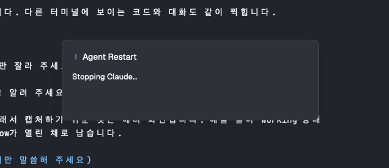

# Agent Restart for the Herdr app

Press `cmd+r` on an idle Claude Code or Codex agent. The agent exits, and the same
session resumes in the same terminal.



## Install

Ask your agent in the Herdr app to add this mod from this repo. Or copy it by hand:

1. Copy `mods/agent-restart/` to `~/.config/herdr-app/mods/`.
2. Add the key from `keys.json` to the `global` section of `~/.config/herdr-app/keys.json`.
3. Run `herdr-app check ~/.config/herdr-app/mods/agent-restart`.

## Supported

- Claude Code.
- Codex started with `--no-daemon`, or started as `codex resume <uuid>`.
- Local terminals only. Tested on macOS only.

How it works, what it reads and runs, and its limits: [RECIPE.md](RECIPE.md).

Idea from the Herdr plugin
[hmu332233/herdr-agent-restart](https://github.com/hmu332233/herdr-agent-restart).

## Test

```sh
cd mods/agent-restart && node --test
```

## License

[MIT](LICENSE)
