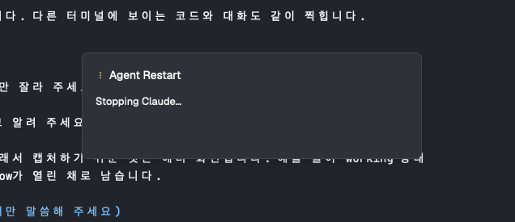

# Agent Restart

Press `cmd+r` on a Claude Code, Codex, Grok or Antigravity agent that is waiting for input. A small
window opens and shows each step. The agent exits, and the same session resumes in the
same terminal (`claude --resume <id>`, `codex resume <id>`, `grok --resume <id>`, `agy --conversation=<id>`). The window then
closes, and the keyboard goes back to that terminal. If a check fails, the window keeps
the reason until you press any key. Use it when an agent's screen breaks (for example,
after you connect or disconnect a monitor) or when an agent needs a restart to update.

The idea comes from the Herdr plugin
[hmu332233/herdr-agent-restart](https://github.com/hmu332233/herdr-agent-restart).
This mod is a new build for the Herdr app.

`cmd+shift+r` opens a second mod, Agent Restart All. It lists every idle Claude Code, Codex,
Grok and Antigravity agent on this computer, asks once, then restarts them one at a time.



## What you see

- One window, 420×132 px, centered over the layout (`mod.json` overlay `kind: "window"`).
  It has the `popover` background, an 8 px radius, 16 px padding, and a 10 px gap
  between rows. Text is 13 px.
- **Header row** (8 px gap):
  - While it runs: a braille spinner (`⠋⠙⠹⠸⠼⠴⠦⠧⠇⠏`, 90 ms per frame) in the `working` color.
  - After a failure: a semibold `!` in the `blocked` color.
  - The title "Agent Restart", 14 px, semibold, `foreground`.
  - After a failure only: "Any key closes", 11 px, `dim`, on the right.
- **Body**: one line that scrolls if it is long.
  - While it runs: the step in `muted`: "Checking the agent…", "Stopping Claude…",
    "Resuming Claude…" ("Codex", "Grok", "Antigravity" for those agents). Codex adds "Reading what Codex printed…"
    before "Resuming Codex…".
  - After a failure: the reason in `foreground`.
- **Close button** (after a failure only), bottom right: 28 px high, 12 px side padding,
  6 px radius, 1 px `input` border, `raised` background, 12 px text, 0.88 opacity on hover.

- **Agent Restart All**: one window, 480×320 px, same look. The header has `↻` (a spinner
  while it runs, `!` after a failure), the title, and a hint on the right ("Enter
  restarts · Esc cancels", then "Any key closes"). Below it: one line ("Restart 8 idle
  agents? 13 other terminals stay as they are.", then "3/8 t1n: Stopping Codex…", then
  "7 restarted, 1 failed."), and a list that scrolls: the targets (`t1n  Codex`, with
  the terminal's place in 11 px `dim`) before the start, the failures with their reasons
  in the `blocked` color after it.

## How it behaves

- `cmd+r` runs `mod.open:agent-restart` on the focused terminal. Pressing `cmd+r` again
  while the window is open closes the window and cancels the restart.
- Agent status decides what happens:
  - `idle` and `done` (idle that nobody has looked at yet): it restarts the agent.
  - `working`, `blocked`, `error`: it refuses ("Claude is working, not idle.").
- These checks all pass before the first key goes to the terminal. If one fails, the
  terminal gets no input:
  1. A terminal is focused, and it is on this computer (not `machine/t7`).
  2. The terminal reports an agent, and the agent is Claude Code, Codex, Grok or Antigravity.
  3. The status is `idle` or `done`.
  4. The terminal's own program is a shell (`argv[0]`). If the agent is the terminal's
     own program, exiting it closes the pane.
  5. The agent is in the foreground (`foreground.pid` is not the shell's `pid`).
  6. The session ID is found and is a UUID. One exception: a daemon-mode Codex (below).
- Then it presses `esc` once. Then it reads the terminal every 400 ms and presses `ctrl+c`
  until the shell is back in the foreground (`foreground.pid === pid`). It stops after
  5 seconds and sends no resume command.
- Codex only: it reads the screen (`hc read <t>`) for the reconnect command Codex prints
  when it exits, up to 8 times, 250 ms apart ("Reading what Codex printed…"). That ID
  wins over the one found before.
- Then it types the resume command at the shell prompt and presses Enter (`hc send`).
- **Daemon-mode Codex** (started without `--no-daemon`): its ID may be unknown before it
  exits. The shared daemon keeps the session after Codex exits ("Any running work
  continues"), and Codex prints:

  ```
  Disconnected from this task. Any running work continues.
  To reconnect, run:
    codex resume <uuid>
  ```

  The mod resumes that ID with `codex resume <uuid>` (no `--no-daemon`: the session lives
  on in the daemon). If the message is not on the screen, it sends nothing, and the
  command Codex printed stays on the screen.
- Success: the window closes and focuses the terminal (`pane.focus {terminal}`).
- Failure: the window stays. Any key or the Close button closes it and focuses the terminal.
- While it runs, the window holds the keyboard. Keys go nowhere, and `Esc` does not close it.
- **Agent Restart All** (`cmd+shift+r`):
  - It reads `hc ls --json`. A target is a terminal on this computer that is live, runs
    Claude Code, Codex, Grok or Antigravity, and is `idle` or `done`. All other terminals are only counted.
  - It sends nothing until you press Enter. Esc closes the window.
  - Then it runs the sequence above on each target, one at a time, with every check
    again. A target that fails (for example, it started working meanwhile) is recorded,
    and the next one runs.
  - No failure: the window closes and focuses the terminal that had the focus. Otherwise
    the window lists the failures until you press any key.
  - `cmd+shift+r` again while it runs closes the window and cancels the rest. The agent
    that was stopping then may get no resume command.

## Built from

- `mods/agent-restart/`, opened by `mod.open` (no layout block, `"place": "none"`):
  - `main.js`: the window. In `init` it reads `focused()` (`shown ?? terminal`) before it
    takes the keyboard (`cx.focus_handle()`), then runs the restart in `cx.spawn`.
  - `restart.js`: the checks, the stop loop and the resume. It imports nothing from
    `herdr`, so `node --test` can test it with fake I/O.
  - `sessions.js`: finds the session ID.
  - `agents.js`: the agents, keyed by the app name they report (`status.app`):
    `claude-code`, `codex`, `grok` and `antigravity`.
  - `ops.js`: the real I/O, through `hc`, `exec`, `readTextFile` and `home`.
  - `test/restart.test.mjs`: 35 unit tests.
- `mods/agent-restart-all/`: `main.js` (its window) and exact copies of `restart.js`,
  `sessions.js`, `agents.js` and `ops.js`. A mod cannot import from another folder
  (`herdr-app check` refuses it). A unit test fails if the copies differ.
  `restart.js` has `planAll` (the targets) and `restartAll` (the loop).
- `herdr` functions: `focused`, `props`, `closeOverlay`, `run("pane.focus")`, `theme`,
  `hc`, `exec`, `readTextFile`, `home`. From `gpui-kit`: `View`, `div`, `.frames`.
  From `gpui-base`: `v_flex`, `h_flex`.
- `hc` commands: `hc get <t> --json`, `hc keys <t> esc`, `hc keys <t> ctrl+c`,
  `hc read <t>` (the visible screen), `hc send <t> "<resume command>"`, `hc ls --json`.
- Each agent in `agents.js` has `prepare(term, ops)` (before any key: what to resume, or
  an error), an optional `confirm(address, plan, ops)` (after the exit: the final ID) and
  `resume(id, plan)` (the command).
- How it finds the session ID:
  - **Claude Code** writes `~/.claude/sessions/<pid>.json` while it runs. The mod reads
    `sessionId` for the foreground pid. The record's `pid` must match, and its `procStart`
    must equal `env LC_ALL=C TZ=UTC ps -o lstart= -p <pid>`, so a stale record with a
    reused pid is refused.
  - **Codex**, before it stops: `lsof -nP -p <pid> -Fn`. Exactly one open
    `…/sessions/…rollout-…-<uuid>.jsonl` gives the ID and means `--no-daemon`. Several are
    refused. With none, the first UUID after `resume` in the process argv
    (`codex resume <uuid>`) gives the ID. `--no-daemon` in the argv also means no daemon.
    A `--no-daemon` Codex with no ID is refused; a daemon-mode Codex may go on without one.
  - **Codex**, after it exits: the newest `To reconnect, run:` line, then a line that is
    only `codex resume <uuid>`. After it, only Codex's "Stop the current turn…" and
    "Token usage…" lines and at most 3 prompt lines may follow, and none may mention
    `codex` (an older message is followed by the command that started Codex again).
    Without it, a `--no-daemon` Codex keeps the ID found before; a daemon-mode Codex
    gets no resume command.
- Keys: `keys.json` binds `cmd-r` and `cmd-shift-r` in `global`.
- No art, no network.

## Watch out

- **The mod runs programs and reads files outside its folder.** It runs `hc`, `ps` and
  `lsof`, and it reads `~/.claude/sessions/`. It never reads the `.key` files there.
- Don't name a method `close` on the exported `View`. Herdr calls `close(cx)` when the
  overlay goes. This build uses `dismiss`.
- Use `kind: "window"`. A popup or a dialog closes on `Esc` or on a click beside it, and a
  closed overlay cancels the mod's task. That can happen after the agent stops and before
  the resume command.
- Read `focused()` in `init`, before the mod focuses itself.
- "The agent exited" means the shell is back in the foreground: `foreground.pid === pid`.
  At a shell prompt the two are equal; while a command runs they differ.
- `procStart` matches `ps -o lstart` only in the C locale and UTC.
- The session ID goes into a shell command line. Accept only a UUID.
- **Daemon-mode Codex breaks the "every check first" rule.** The shared daemon holds the
  rollout file and the Codex TUI process holds none, so nothing ties the terminal to its
  session before the exit. The ID comes from what Codex prints on exit. The argv ID
  (`codex resume <uuid>`) can be stale if the session changed inside Codex, so for a
  daemon-mode Codex it is never used alone.
- `hc read` right after the exit gave the shell screen with the reconnect message in the
  one daemon-mode test on macOS. If it returns Codex's transcript instead, the reconnect
  command won't match, and the mod stops without a resume command. The error names the
  ID Codex showed before it stopped, if any.
- Keep `RESUME_LINE` strict: a line that is only `codex resume <uuid>`, right after
  `To reconnect, run:`. A looser pattern would match a prompt line where someone typed
  the command. A `codex resume --no-daemon <uuid>` line does not match; a `--no-daemon`
  Codex falls back to the ID it showed before it stopped.
- Keep Codex's mode on resume. Don't add `--no-daemon` to a daemon-mode session: the
  daemon still holds it. `hc --skill` says Codex must run with `--no-daemon` in hc.
  - **Grok** writes `~/.grok/active_sessions.json` while it runs: a list with one entry per
    process (`session_id`, `pid`, `pid_start`, `cwd`). The mod reads the one entry whose
    `pid` is the foreground pid. Two entries for one pid are refused. `pid_start` is the
    process start in microseconds since the epoch; it must be within 1 second of
    `env LC_ALL=C TZ=UTC ps -o lstart= -p <pid>`, so a stale entry with a reused pid is
    refused. Grok removes its entry when it exits, so the mod reads it before it stops
    Grok.
  - **Antigravity** (`agy`) opens `~/.gemini/antigravity-cli/conversations/<uuid>.db` when
    a conversation starts and holds it while it runs. The mod runs `lsof -nP -p <pid> -Fn`
    and takes the one `<uuid>.db` (the `-wal` and `-shm` files beside it do not count). None
    means no message was sent yet: it refuses, since there is nothing to resume. Two are
    refused. The ID is the same as the `conversation_id` in the statusline JSON.
- Only the session ID comes back (and `--no-daemon` if Codex had it). Other CLI options (model,
  permission mode, extra folders, inline env vars) do not. A draft in the input box is lost.
- Grok quits on a second `ctrl+c` (its default; `ui.single_ctrl_c_quit` changes that). The
  stop loop presses `ctrl+c` until the shell is back, so both settings work. A resumed
  Grok does not get options such as `--always-approve` or `--model` back.
- Antigravity quits on a second `ctrl+c` and prints `agy --conversation=<id>`. The mod
  does not read that message: the `lsof` result is already exact. `~/.gemini/antigravity-cli/.last-statusline.json`
  also holds a `conversation_id`, but all `agy` processes share that file, so the mod
  does not use it.
- Other agents are not supported. No source ties their process to a session
  without guessing. To add one, add an entry to `agents.js` whose `prepare` does not
  guess.
- Local terminals only.
- Tested on macOS only (`ps -o lstart`, `lsof`).
- Change `restart.js`, `sessions.js`, `agents.js` or `ops.js` in `agent-restart`, then
  copy the file to `agent-restart-all`.
- Not tested in the app: an Antigravity restart with `cmd+r`. On a throwaway terminal,
  outside the mod, `lsof` showed the conversation database after the first message,
  `ctrl+c` twice quit `agy`, and `agy --conversation=<id>` opened the same conversation
  with its history. The checks on a live `agy` terminal were not run: none was open.
- Not tested in the app: a Grok restart with `cmd+r`. On a throwaway terminal, outside the
  mod, `ctrl+c` twice quit Grok, and `grok --resume <id>` opened the same session ID
  again. Agent Restart All was run once in the app; it was not run on every agent.
- `hc keys`, `hc read` and `hc send` work on a
  terminal without the focus (tested on a plain shell that ran `cat`).
- Not tested in the app: a `--no-daemon` Codex restart. That covers the `lsof` path and
  whether a `--no-daemon` Codex prints the same message.

## Done when

- `herdr-app check` passes for `mods/agent-restart` and `mods/agent-restart-all`.
- `node --test` in `mods/agent-restart` passes: 35 tests.
- `cmd+r` on an idle Claude Code pane: the window shows "Stopping Claude…", Claude exits,
  `claude --resume <id>` runs in the same terminal, the same conversation opens again, and
  the window closes.
- The checks on two live idle Grok terminals found each one's session ID, and the resume
  command was `grok --resume <id>`. A working Claude was refused.
- `cmd+r` on an idle daemon-mode Codex started as `codex resume <uuid>`: Codex exits,
  `codex resume <uuid>` runs in the same terminal, and the same session opens again. A
  daemon-mode Codex has no fallback ID, so the resume command came from the exit message.
- The checks, run on live terminals without sending keys:
  - Idle or done Claude: the session ID is found. Claude's record for a running
    conversation holds that conversation's ID.
  - Working Claude: "Claude is working, not idle."
  - Daemon-mode Codex started as `codex resume <uuid>`: the checks pass, and the resume
    command keeps daemon mode (`codex resume <uuid>`).
- By hand, outside the mod: `ctrl+c` on a daemon-mode Codex printed the reconnect message
  above, and `codex resume <uuid>` reopened the same session.
